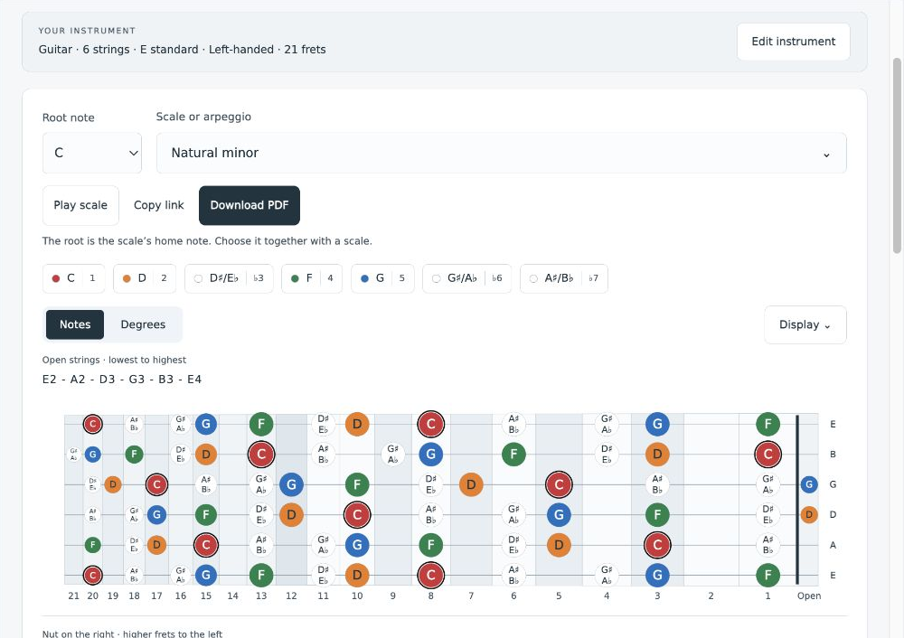
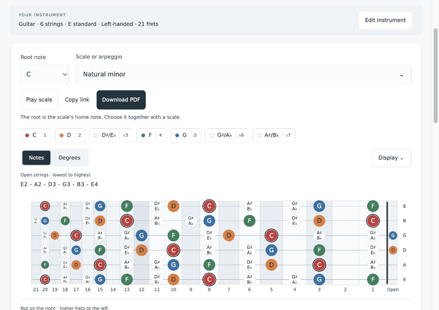
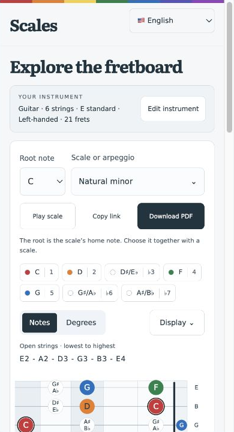
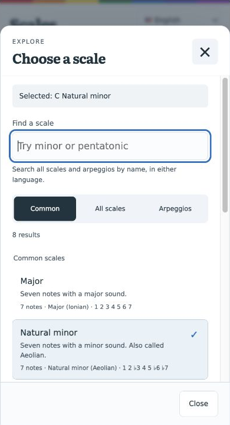
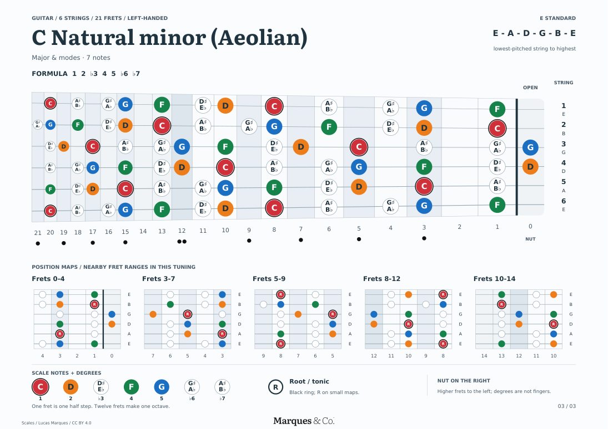

# Scales

**Explore guitar and bass scales, hear the notes, and take the same fretboard into a printable guide.**

[](https://github.com/lucasmkrx/scales/actions/workflows/pages.yml)
[](LICENSE)

[**Try the live app**](https://lucasmkrx.github.io/scales/) · [Português](https://lucasmkrx.github.io/scales/?lang=pt) · [Case study](docs/case-study.md) · [Architecture](docs/architecture.md)



Scales helps players who learned songs from TAB connect familiar fret positions
with notes, scale degrees, and improvisation. Change the instrument, tuning, or
handedness and every diagram is recalculated from the sounding pitches. Playback
and PDF generation happen in the browser; the deployed app needs no account,
backend, analytics, or external API.

## See it work



Try [A minor pentatonic on guitar](https://lucasmkrx.github.io/scales/?instrument=guitar&strings=6&tuning=guitar-standard&hand=right&lang=en&root=9&spelling=both&scale=minor-pentatonic&frets=21&labels=notes&allNotes=false)
or [D natural minor on Drop C bass](https://lucasmkrx.github.io/scales/?instrument=bass&strings=4&tuning=bass-4-drop-c&hand=right&lang=en&root=2&spelling=both&scale=natural-minor&frets=20&labels=notes&allNotes=false).
Play the scale, switch between notes and degrees, then download the selected map.
These examples demonstrate the controls; choosing a scale for a backing track
also depends on its chords.

<details>
<summary>Mobile workspace and printable output</summary>

<p>


</p>



</details>

## What you can explore

- **67 scales, modes, and chord arpeggios**, transposable to all 12 roots.
- **44 tuning presets** for 6- and 7-string guitar and 4-, 5-, and 6-string bass,
  plus custom tuning pitches and scale formulas.
- Left- and right-handed fretboards, 20–24 fret options, note or degree labels,
  and shared sharp/flat names on a single pitch marker.
- American English and Brazilian Portuguese, remembered instrument setups,
  keyboard controls, and shareable URLs.
- Locally synthesized guitar and bass playback, plus vector PDF atlases for a
  scale, a family, or the named catalog.
- Four [guided books](public/guides/), matched to language, instrument, string
  count, handedness, and tuning. Other combinations use generated scale atlases.

## Engineering highlights

| Decision                       | Purpose                                                                | Where to look                                                      |
| ------------------------------ | ---------------------------------------------------------------------- | ------------------------------------------------------------------ |
| Shared pitch model             | Keep web and PDF notes consistent across tunings and handedness        | [Music engine](src/music.mjs)                                      |
| Separate drawing geometry      | Mirror coordinates while keeping text and string order readable        | [SVG rendering](src/board.mjs), [PDF layout](src/guide-layout.mjs) |
| Procedural plucked strings     | Provide instrument-specific playback without recorded sample downloads | [Audio engine](src/string-audio.mjs)                               |
| Validated URL and device state | Make links reproducible while remembering local setups                 | [Workspace state](src/workspace.mjs)                               |
| Lazy PDF dependencies          | Load PDF tooling when a download is requested                          | [App controller](src/app.mjs), [PDF generator](src/pdf.mjs)        |
| Revisioned module graph        | Prevent a new entry point from loading stale JavaScript dependencies   | [Static build](scripts/build.mjs)                                  |

The app uses native browser modules, SVG, Web Audio, and local font assets.
Node.js provides the test runner, static build, preview server, and PDF CLI.
pdf-lib and fontkit are vendored with their license notices; Prettier is the only
npm development dependency. See the [design tradeoffs](docs/architecture.md#decisions-and-tradeoffs)
and [project case study](docs/case-study.md) for the reasoning behind this approach.

## Run locally

Use **Node.js 22 or newer**. Running the app and its tests does not require npm installation:

```sh
node --test tests/*.test.mjs
node scripts/build.mjs
node scripts/serve.mjs
```

Open **http://127.0.0.1:4173**. The build goes into `dist/` and uses relative paths,
so it also works under GitHub Pages' `/scales/` project path.

To install the pinned formatting tool:

```sh
npm ci
npm run format:check
```

Use `npm run format` to format maintained source, tests, and documentation.
Vendored libraries, fonts, generated files, and guide PDFs are excluded.

## Validation

The current suite has **34 automated tests**. Pitch-model tests enumerate
**35,376 tuning/scale/root combinations**; other checks cover mirrored geometry,
custom input rejection, shared state, PDF navigation and font embedding, and
synthesized pitch at two sample rates. GitHub Actions runs formatting checks,
tests, and the build before publishing pushes to `main`.

Browser flows and visual output receive separate manual checks. See
[testing and known limits](docs/testing.md) for the evidence, reproduction
commands, release checklist, and current limits.

## Generate a PDF

```sh
node scripts/generate.mjs --instrument=bass --strings=6 \
  --tuning=bass-6-standard --hand=left --lang=en --root=2 \
  --scale=natural-minor --output=work/d-minor-bass.pdf
```

Use `--scope=family` or `--scope=catalog` for an atlas. `--allKeys=true` applies
to one selected scale. The CLI shares the browser's PDF generator.

## Project notes

- [Case study: from learning PDFs to an interactive explorer](docs/case-study.md)
- [Architecture, data flow, and tradeoffs](docs/architecture.md)
- [Testing, release checks, and limitations](docs/testing.md)
- [Roadmap](docs/roadmap.md)
- [Contributing](CONTRIBUTING.md)
- [Musical and implementation references](docs/references.md)

Maintained by [Lucas Marques](https://github.com/lucasmkrx). The
[case study](docs/case-study.md#development-process) describes the project's
iterative development and AI assistance.

## Licenses

- Code: [MIT](LICENSE).
- Original educational content and guides: [CC BY 4.0](CONTENT-LICENSE.md).
- Marques & Co. logo: [separate branding terms](BRANDING.md).
- Fonts and vendored libraries: [third-party notices](THIRD-PARTY-NOTICES.md).
