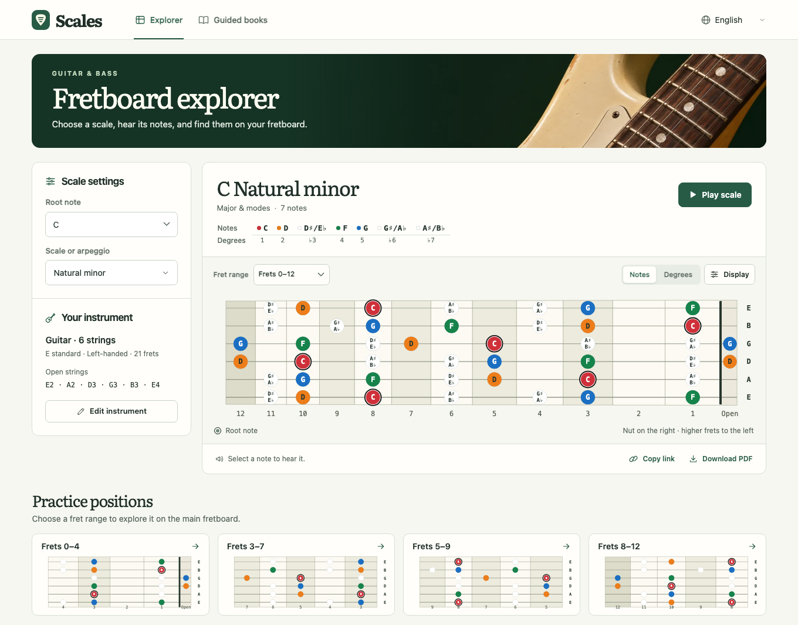
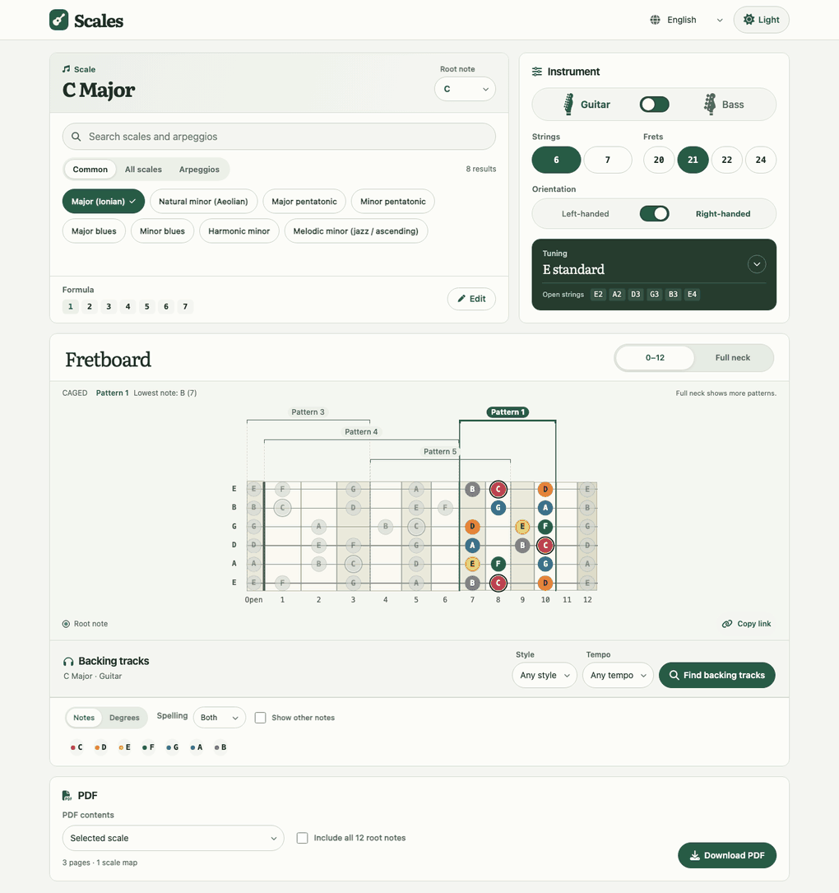
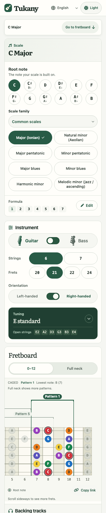
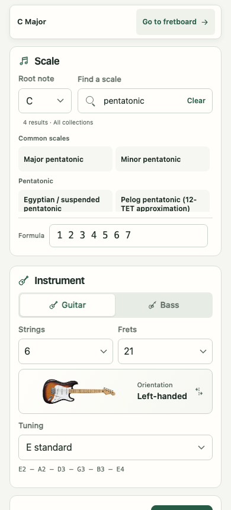
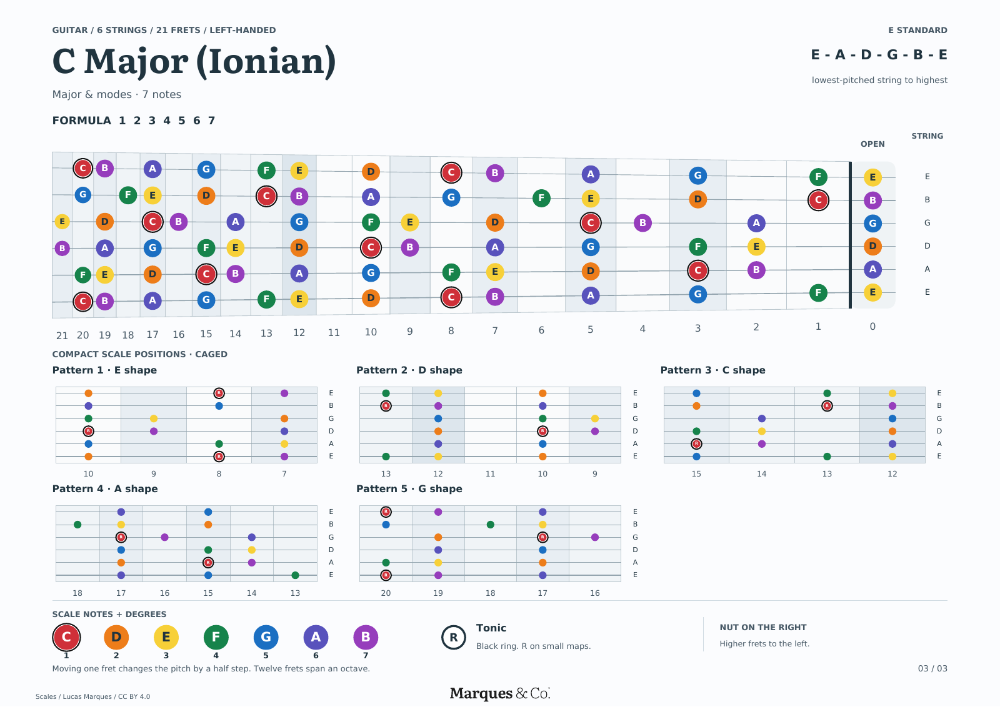

# Tukany

**Explore guitar and bass scales, hear the notes, and take the same fretboard into a printable guide.**

[](https://github.com/lucasmkrx/tukany/actions/workflows/pages.yml)
[](LICENSE)

[**Try the live app**](https://tukany.com/) · [Português](https://tukany.com/pt/) · [Español](https://tukany.com/es/) · [Case study](docs/case-study.md) · [Architecture](docs/architecture.md)

[Browse the scale formulas and notes](https://tukany.com/scales/) or [try three guided fretboard exercises](https://tukany.com/practice/).



Tukany helps players who learned songs from TAB connect familiar fret positions
with notes, scale degrees, and improvisation. Change the instrument, tuning, or
handedness and every diagram is recalculated from the sounding pitches. Note playback
and PDF generation run locally. To play along, [search for backing tracks](docs/backing-tracks.md)
on YouTube in a new tab and return to the fretboard while the track plays.

## See it work



Try [A minor pentatonic on guitar](https://tukany.com/?instrument=guitar&strings=6&tuning=guitar-standard&hand=right&lang=en&root=9&scale=minor-pentatonic&frets=21&labels=notes&allNotes=false)
or [D natural minor on Drop C bass](https://tukany.com/?instrument=bass&strings=4&tuning=bass-4-drop-c&hand=right&lang=en&root=2&scale=natural-minor&frets=20&labels=notes&allNotes=false).
The compact scale browser and instrument settings sit side by side above the
fretboard on wider screens. They stack on phones, with scale selection first.
Choose a root note directly on the card, then pick a scale. Common scales appear
first on a fresh visit. To find Dorian, for example, open **Scale family**, choose
**Major & modes**, then select **Dorian**. Browsing families keeps the current
scale on the fretboard. Select **Edit** beside the formula to enter your own degrees.
PDF customization stays inline below the playing surface, with contents, reference-note options, a page estimate, and Download PDF. Repeated setup summaries and instructional sections are omitted.
On phones, a sticky current-scale shortcut jumps directly to the fretboard while
keeping every setting on the homepage.
The instrument card has sliding switches for Guitar or Bass and Right-handed
or Left-handed. Right-handed is the first option and the default. Your orientation
applies to both instruments and is saved for your next visit. Each instrument
recalls its string count and last tuning, including custom pitches. The tuning picker shows the open strings
from lowest to highest.
The fretboard starts at frets 0–12. A sliding switch in the
fretboard header reveals the full neck. Thin pattern brackets sit above the
frets they cover, labeled Pattern 1, Pattern 2, and so on.
Vertical boundary guides connect each bracket to the neck. Click one to highlight its exact string-and-fret shape;
click it again to return the visible scale notes to color.
A compact caption identifies the selected pattern and its lowest note. Each bracket’s tooltip and accessible description include its fret range and shape or starting string.
Six-string guitar offers five compact CAGED positions for major and natural
minor, five two-notes-per-string shapes for major/minor pentatonic, and five
blues patterns with the extra blue notes. The other major-scale modes, harmonic
and melodic minor with their modes, and whole-tone scales use three notes per
string. Diminished scales use four notes per string. Seven-string guitar uses
three-notes-per-string routes for major/minor instead of extending the CAGED
templates. Patterns support standard tuning intervals and uniform detuning.
Bass offers generated compact octave routes. Other notes turn gray while a pattern is selected.
Tap a note on the fretboard, staff, or reference row to hear it and highlight
where it appears. On the staff, arrow keys move between notes and Enter or Space
plays the focused note. The staff below the fretboard uses treble clef for
guitar and bass clef for bass. It shows each displayed pitch as a quarter note
one octave above its sounding pitch. Fingerings that sound the same
pitch share a notehead. The staff is monochrome until you select a pattern.
The pattern's noteheads then take their fretboard colors while the stems use
the staff ink. Each colored head shows its written letter, and the other pitches
fade. Selecting a fret places a small pointer below its exact pitch.
The key signature appears after the clef. In D harmonic minor, for example, the
signature supplies B♭ and the staff writes C♯ beside the raised seventh.
See the [staff notation conventions](docs/references.md#staff-notation).
Note names follow the scale’s written degrees. When a key has two common names,
use **Write key as** to choose between them, such as F♯ major or G♭ major.
The Scale card always offers the same 12 root notes.
Tukany opens in Light on first visit, even on a device set to dark mode. Use the
sun-and-moon button in the header to switch themes. Tukany remembers your choice
on this device. Selection and note animations respect the device's
reduced-motion setting.
See the [dark desktop](docs/assets/desktop-dark.png) and
[dark mobile](docs/assets/mobile-dark.png) previews.
Only complete patterns that fit the selected view are offered. A whole pattern
can move by an octave to fit; its notes are never clipped individually. Full neck
reveals patterns that do not fit frets 0–12. The app remembers your view and
selection, and copied links reopen them. Unsupported scales or tunings keep a
note map with an explanation.
PDF settings below the fretboard show the contents, reference-note options, and
page estimate before you download.
These examples demonstrate the controls; choosing a scale for a backing track
also depends on its chords.

<details>
<summary>Mobile workspace and printable output</summary>

<p>


</p>



</details>

## What you can explore

- **67 scales, modes, and chord arpeggios**, transposable to all 12 roots.
- **44 tuning presets** for 6- and 7-string guitar and 4-, 5-, and 6-string bass,
  plus custom tuning pitches and scale formulas.
- Left- and right-handed fretboards, 20–24 fret options, note or degree labels,
  and shared sharp/flat names on a single pitch marker.
- American English (`en-US`), Brazilian Portuguese (`pt-BR`), and Latin American Spanish (`es-419`), remembered instrument setups,
  keyboard controls, and shareable URLs.
- Scale-derived fingering patterns that highlight exact string and fret positions,
  plus a note-map fallback for unsupported shapes.
- Individual guitar and bass notes synthesized locally.
- Inline PDF customization with a Download PDF action beneath the fretboard.
  Choose the current scale, its family, or the full catalog, with all 12 reference
  notes available for a selected scale.

The [design notes](docs/design.md) explain the research and layout decisions.

## Engineering highlights

| Decision                       | Purpose                                                                | Where to look                                                      |
| ------------------------------ | ---------------------------------------------------------------------- | ------------------------------------------------------------------ |
| Shared pitch model             | Keep web and PDF notes consistent across tunings and handedness        | [Music engine](src/music.mjs)                                      |
| Separate drawing geometry      | Mirror coordinates while keeping text and string order readable        | [Web fretboard](src/board.mjs), [PDF layout](src/guide-layout.mjs) |
| Procedural plucked strings     | Provide instrument-specific playback without recorded sample downloads | [Audio engine](src/string-audio.mjs)                               |
| Validated URL and device state | Make links reproducible while remembering local setups                 | [Workspace state](src/workspace.mjs)                               |
| Lazy PDF dependencies          | Load PDF tooling when a download is requested                          | [App controller](src/app.mjs), [PDF generator](src/pdf.mjs)        |
| Revisioned module graph        | Prevent a new entry point from loading stale JavaScript dependencies   | [Static build](scripts/build.mjs)                                  |

The app draws the fretboard with HTML and CSS, plays notes with Web Audio,
and serves Font Awesome Free icons locally.
Node.js provides the test runner, static build, preview server, and PDF CLI.
pdf-lib and fontkit are vendored with their license notices. Prettier and Playwright
are development dependencies. See the [design tradeoffs](docs/architecture.md#decisions-and-tradeoffs)
and [project case study](docs/case-study.md) for the reasoning behind this approach.

## Run locally

Use **Node.js 22 or newer**. Running the app and its tests does not require npm installation:

```sh
node --test tests/*.test.mjs
node scripts/build.mjs
node scripts/serve.mjs
```

Open **http://127.0.0.1:4173**. The build goes into `dist/` and uses relative paths,
so it also works under GitHub Pages' `/tukany/` project path.

To install the pinned formatting tool:

```sh
npm ci
npm run format:check
```

Use `npm run format` to format maintained source, tests, and documentation.
Vendored libraries, fonts, generated files, and guide PDFs are excluded.

## Validation

The automated pitch-model tests enumerate
**35,376 tuning/scale/root combinations**; other checks cover mirrored geometry,
custom input rejection, shared state, PDF navigation and font embedding, and
synthesized pitch at two sample rates. GitHub Actions runs formatting checks,
tests, the build, and Playwright browser checks before publishing pushes to `main`.

Run the browser suite locally after installing its engines:

```sh
npm ci
npx playwright install chromium firefox webkit
npm run test:browser
```

The suite covers Chromium, Firefox, and WebKit, including mobile layouts,
pattern selection, key spelling, saved settings, audio controls, PDF downloads,
theme preferences, and reduced-motion behavior.

Browser flows and visual output receive separate manual checks. See
[testing and known limits](docs/testing.md) for the evidence, reproduction
commands, release checklist, and current limits.

## Generate a PDF

```sh
node scripts/generate.mjs --instrument=bass --strings=6 \
  --tuning=bass-6-standard --hand=left --lang=en --root=2 \
  --scale=natural-minor --output=work/d-minor-bass.pdf
```

Use `--scope=family` or `--scope=catalog` for an atlas. `--allKeys=true` applies
to one selected scale. The CLI shares the browser's PDF generator.

## Project notes

- [Case study: from learning PDFs to an interactive explorer](docs/case-study.md)
- [Architecture, data flow, and tradeoffs](docs/architecture.md)
- [Testing, release checks, and limitations](docs/testing.md)
- [Search discovery and sitemap submission](docs/discovery.md)
- [Roadmap](docs/roadmap.md)
- [Contributing](CONTRIBUTING.md)
- [Musical and implementation references](docs/references.md)
- [Original English and Portuguese lesson PDFs](public/guides/)

Maintained by [Lucas Marques](https://github.com/lucasmkrx). The
[case study](docs/case-study.md#development-process) describes the project's
iterative development and AI assistance.

## Licenses

- Code: [MIT](LICENSE).
- Original educational content and guides: [CC BY 4.0](CONTENT-LICENSE.md).
- Marques & Co. logo: [separate branding terms](BRANDING.md).
- Icons, fonts, and vendored libraries have their own [third-party notices](THIRD-PARTY-NOTICES.md).
