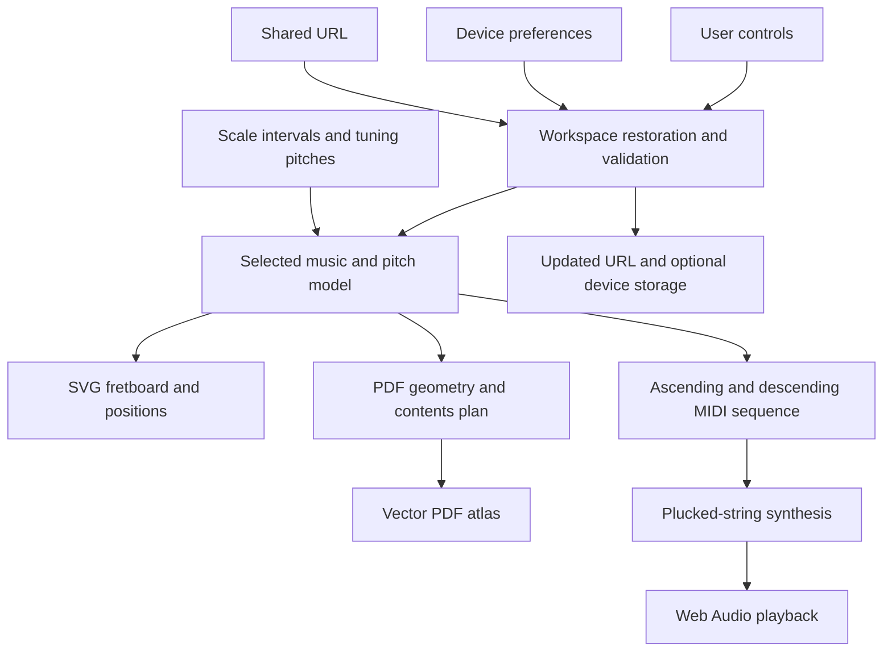

# Architecture and engineering decisions

Scales is a static browser application with a shared music model, SVG rendering,
Web Audio playback, and vector PDF export. Node.js is used for development,
testing, the static build, and an optional PDF command-line entry point.

## Data flow

The central invariant is `sounding MIDI pitch = open-string pitch + fret`.
A pitch class is that value modulo 12. Scale membership is checked relative to
the selected root; the displayed label is separate from the sounding pitch.

## Module boundaries

| Module                                      | Responsibility                                                                                      |
| ------------------------------------------- | --------------------------------------------------------------------------------------------------- |
| [catalog.mjs](../src/catalog.mjs)           | Scale intervals, formulas, bilingual names, aliases, tuning pitches, and mode rotation              |
| [music.mjs](../src/music.mjs)               | Validate selections; calculate notes, degrees, SVG coordinates, shared URLs, and playback sequences |
| [workspace.mjs](../src/workspace.mjs)       | Restore preferences, recall instrument setups, resolve URL precedence, and estimate PDF pages       |
| [scale-picker.mjs](../src/scale-picker.mjs) | Curate common choices and search the bilingual catalog without changing the active scale            |
| [board.mjs](../src/board.mjs)               | Render the shared model into keyboard-accessible SVG markup                                         |
| [guide-layout.mjs](../src/guide-layout.mjs) | Compute tapered PDF geometry, bass octave routes, and paginated contents                            |
| [pdf.mjs](../src/pdf.mjs)                   | Draw PDF pages, embed local fonts and branding, and add internal links and outlines                 |
| [string-audio.mjs](../src/string-audio.mjs) | Synthesize strings and manage cached buffers, gain, scheduling, and cancellation                    |
| [guides.mjs](../src/guides.mjs)             | Match the four existing guided books against the actual configuration                               |
| [i18n.mjs](../src/i18n.mjs)                 | Interface copy and concise educational descriptions in English and Brazilian Portuguese             |
| [app.mjs](../src/app.mjs)                   | Coordinate DOM controls, dialogs, rendering, playback, and downloads                                |

The pure model and layout functions can be tested without a browser. The DOM and
Web Audio integration remain in their respective controllers. See
[testing.md](testing.md) for what this separation currently verifies.

## Decisions and tradeoffs

### Native modules and static hosting

The interface uses native ES modules and browser APIs, with a small Node build
script. This keeps the deployed product compatible with GitHub Pages and avoids
requiring a server for state, playback, or export. The build copies maintained
source and local public assets rather than running a framework compiler.

The tradeoff is manual coordination of DOM state and rendering. As the interface
grows, browser-flow tests and careful controller boundaries become more valuable.
The current implementation is not evidence that a framework would be unsuitable
for a larger application.

### One musical model, two renderers

Both renderers calculate from the same interval and tuning data. Changing tuning
changes each note and position. Handedness mirrors horizontal coordinates while
retaining string order and readable text. SVG and PDF use different coordinate
systems and density constraints, so they have separate layout functions.

This prevents duplicated musical facts, but does not eliminate separate visual
QA. The PDF uses a continuous tapered neck; the web uses its own SVG layout.
Guitar windows describe nearby notes, while bass routes derive an ascending
octave from the two lowest strings. A route that cannot be reached under an
extreme custom tuning falls back to a position map.

### Sounding pitches, note labels, and degree formulas

Tunings store actual MIDI pitches including octave numbers, ordered from lowest
to highest. This distinguishes extended strings and octave-shifted custom tunings
that share the same note letters. The app supports 6- and 7-string guitar and
4-, 5-, and 6-string bass.

Notes can display both enharmonic names or only sharps/flats. These are display
choices: degree formulas, marker colors, geometry, and audio continue to describe
the same pitches. The app favors familiar note names over enforcing formal
letter-by-letter scale spelling in every key. For example, a ♭3 degree can appear
beside D♯/E♭; the shared marker still represents one pitch.

### Shareable state and device preferences

The URL contains a reproducible musical configuration. On startup, stored
preferences are read defensively, explicit URL fields are applied, and the result
is normalized. Preferences are versioned and optional: unavailable storage does
not prevent use of the app.

Instrument and string-count setups are recalled separately. Changing instrument
keeps the musical selection and restores a compatible setup, with default fret
counts of 21 for guitar and 20 for bass when no explicit choice exists. Custom
tuning and formula edits commit only after validation. Display changes retain
horizontal fretboard position; a new setup starts at its open-string end.

### Focused controls and progressive disclosure

Root and scale sit above the full-width board. Instrument setup, scale browsing,
display, and export use native modal dialogs, presented as sheets at phone widths.
Dialogs return focus to their triggers. Scale results support arrow-key browsing
and explicit selection; search alone never changes the active scale.

This reduces the amount of configuration visible during practice, at the cost of
an extra opening action for secondary settings. Keyboard behavior and actual
assistive-technology compatibility still need broader validation.

### Procedural instrument audio

The string model uses Karplus–Strong synthesis, an averaging loop, a fractional
delay correction, damping, and body coloration. The fractional correction avoids
rounding every note's delay to an integer number of samples. Guitar and bass have
different excitation and decay settings.

An LRU cache holds up to 48 generated mono buffers. Sources play through a gain
stage and compressor. Stop fades active voices and cancels scheduled ones; a
version token invalidates audio starts waiting for a resumed AudioContext.
The app prewarms a scale's unique notes before choosing its schedule start time.

This avoids recorded sample downloads and sample-library licensing. It introduces
DSP complexity and produces a synthesized timbre rather than the range of a
recorded instrument. The tests measure pitch and envelope properties, not
perceptual realism. References are recorded in [references.md](references.md).

### PDF layout and cancellation

pdf-lib and fontkit load on demand. Fonts and the vector logo are local assets.
The generator plans the cover, contents, reading page, and scale pages before
rendering. Export estimates reuse that planner, including additional contents
pages for a large catalog.

The browser captures the selected configuration and export scope before awaiting
libraries or rendering. Progress and cancellation operate on that export, so a
later state change cannot silently rename a PDF generated from an earlier state.
Larger atlases still require more browser memory and time.

### Cache-consistent releases

The build hashes the source modules and stylesheet. It appends that revision to
the entry script, stylesheet URL, and relative module imports throughout the graph.
An updated entry point therefore requests matching dependencies rather than
reusing an older unversioned import. All paths remain relative for project hosting.

This is cache busting, not an offline cache. Formatting changes also change the
revision. CI verifies the published references and tests/builds before deployment.

## Guided books and licensing boundaries

Book matching checks language, instrument, string count, handedness, and sounding
open-string pitches. Equivalent enharmonic custom tunings can match; octave or
string-count differences cannot. The empty state offers a generated scale atlas.

The four [guided books](../public/guides/) retain their original full-course
language, orientation, and tuning. An exported atlas does not become a rewritten
course simply because its instrument configuration is supported.

Code uses MIT; original educational content uses CC BY 4.0. Logo rights and
third-party font/library licenses are documented separately. No recorded samples
are bundled. The app sends no application data to a backend; hosting services
and any external links retain their own policies.

## Extending the system

For a new tuning, provide exact sounding pitches including octaves. For a scale,
provide intervals, degrees, bilingual names, and aliases. Add entries to
`catalog.mjs`, run the tests, and check the web and PDF layouts. Existing shared
links depend on stable IDs, so prefer adding aliases over renaming identifiers.

A new instrument/string count requires validation, controls, audio-range, and
both renderer checks. It should not be implemented solely by adding an option to
a dropdown. See [Contributing](../CONTRIBUTING.md) and the [roadmap](roadmap.md).
