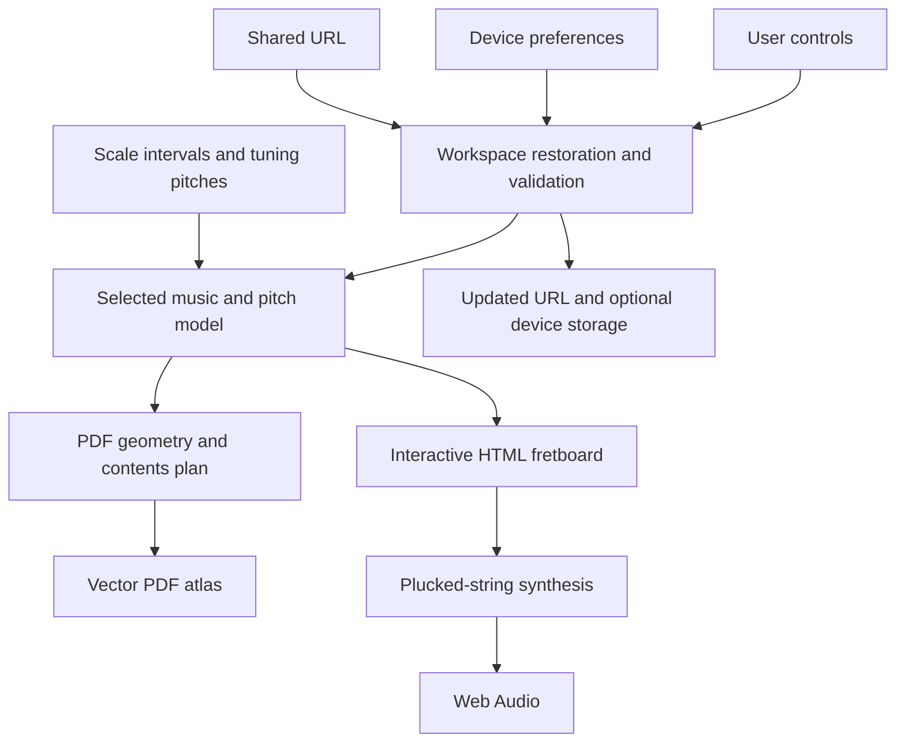

# Architecture and engineering decisions

Scales is a static browser application with a shared music model, an HTML fretboard,
Web Audio playback, and vector PDF export. Node.js is used for development,
testing, the static build, and an optional PDF command-line entry point.

## Data flow

The central invariant is `sounding MIDI pitch = open-string pitch + fret`.
A pitch class is that value modulo 12. Scale membership is checked relative to
the selected root; the displayed label is separate from the sounding pitch.

## Module boundaries

| Module                                          | Responsibility                                                                                                    |
| ----------------------------------------------- | ----------------------------------------------------------------------------------------------------------------- |
| [catalog.mjs](../src/catalog.mjs)               | Scale intervals, formulas, localized names, aliases, tuning pitches, and mode rotation                            |
| [music.mjs](../src/music.mjs)                   | Validate selections and calculate notes, degrees, fretboard coordinates and shared URLs                           |
| [pattern-ranges.mjs](../src/pattern-ranges.mjs) | Align brackets to frets and let separated brackets share a row                                                    |
| [patterns.mjs](../src/patterns.mjs)             | Build complete string/fret fingering sets for supported setups                                                    |
| [intervals.mjs](../src/intervals.mjs)           | Name written intervals in all supported languages                                                                 |
| [workspace.mjs](../src/workspace.mjs)           | Restore preferences, recall instrument setups, resolve URL precedence, and estimate PDF pages                     |
| [scale-picker.mjs](../src/scale-picker.mjs)     | Curate common choices and group the catalog by musical family                                                     |
| [board.mjs](../src/board.mjs)                   | Place frets, strings, note controls, and pattern markers on a keyboard-accessible HTML fretboard                  |
| [guide-layout.mjs](../src/guide-layout.mjs)     | Compute tapered PDF geometry, bass octave routes, and paginated contents                                          |
| [pdf.mjs](../src/pdf.mjs)                       | Draw PDF pages, embed local fonts and branding, and add internal links and outlines                               |
| [string-audio.mjs](../src/string-audio.mjs)     | Synthesize plucked notes, manage cached buffers, and fade stopped sounds                                          |
| [guides.mjs](../src/guides.mjs)                 | Match the four archived lesson PDFs against a configuration                                                       |
| [locales.mjs](../src/locales.mjs)               | Regional language tags, locale normalization, and tuning names                                                    |
| [i18n.mjs](../src/i18n.mjs)                     | Interface copy and educational descriptions in American English, Brazilian Portuguese, and Latin American Spanish |
| [theme.js](../public/theme.js)                  | Apply the saved Light or Dark theme before paint, using Light on the first visit                                  |
| [app.mjs](../src/app.mjs)                       | Coordinate inline controls, draft validation, rendering, playback, and downloads                                  |

The pure model and layout functions can be tested without a browser. The DOM and
Web Audio integration remain in their respective controllers. See
[testing.md](testing.md) for what this separation currently verifies.

## Decisions and tradeoffs

### Native modules and static hosting

The interface uses native ES modules and browser APIs, with a small Node build
script. This keeps the deployed product compatible with GitHub Pages and avoids
requiring a server for state, playback, or export. The build copies maintained
source and local public assets rather than running a framework compiler.

The optional backing-track finder queries YouTube Data API v3 from the browser
after an explicit search. The build writes the website-restricted browser key
to `dist/youtube-config.json`. The player loads when a result is selected.
[Search configuration and query behavior](backing-tracks.md)

The tradeoff is manual coordination of DOM state and rendering. As the interface
grows, browser-flow tests and careful controller boundaries become more valuable.
The current implementation is not evidence that a framework would be unsuitable
for a larger application.

### One musical model, two renderers

Both renderers calculate from the same interval and tuning data. Changing tuning
changes each note and position. Handedness mirrors horizontal coordinates while
retaining string order and readable text. The HTML fretboard and PDF use different coordinate
systems and density constraints, so they have separate layout functions.

Each renderer needs its own visual checks. The PDF uses a continuous tapered neck.
Both renderers use the shared guitar pattern model. The homepage favors complete
first-octave instances where available; the PDF can use a different whole-octave
instance on the full instrument neck. Each renderer uses exact pattern points.
The bass PDF shows octave routes from the two lowest strings; the homepage
offers compact routes from any viable starting string. Unavailable fingerings
retain an explicitly labeled note-map fallback.

### Sounding pitches, note labels, and degree formulas

Tunings store actual MIDI pitches including octave numbers, ordered from lowest
to highest. This distinguishes extended strings and octave-shifted custom tunings
that share the same note letters. The app supports 6- and 7-string guitar and
4-, 5-, and 6-string bass.

Notes can display both enharmonic names, only sharps/flats, or key-aware spelling.
Key spelling derives each letter from the written degree formula, including E♯,
C♭, and double accidentals. The root selector separates common enharmonic tonics;
an optional validated `tonic` value preserves that choice in URLs and saved practice.
Without an explicit tonic, the model chooses the simpler spelling, favoring sharps
on a tie. Contextual MIDI labels retain written octaves, such as B♯3 for sounding C4.
These display choices preserve pitches, colors, geometry, and playback.

### Shareable state and device preferences

The URL contains a reproducible musical configuration. On startup, stored
preferences are read defensively, explicit URL fields are applied, and the result
is normalized. Bare URLs resume the last root, scale, custom formula, neck view,
and selected pattern. New sessions start at frets 0–12; the full-neck view is an
explicit switch choice. Shared URLs encode this as `neck=octave` or `neck=full`;
the device preference is `preferences.neckView`. An explicit neck URL value
takes priority over that saved preference.
Explicit musical links take priority over that saved practice selection. Preferences are versioned and optional: unavailable storage does
not prevent use of the app.

Each instrument remembers its orientation, fret count, and last string count.
Each string count remembers its tuning and custom pitches for that instrument.
Switching instruments keeps the musical selection. New guitar and bass setups
start right-handed, with 21 frets for guitar and 20 for bass. Custom
tuning and formula edits commit only after validation. Display changes retain
horizontal fretboard position; a new setup starts at its open-string end.

The document head applies Light before paint unless the player has saved Dark
under `scales.theme` on this device. Both themes stay consistent across
operating-system appearance changes and shared musical links. When device storage
is unavailable, the button still switches themes for the current visit. A theme
change updates CSS variables while preserving the fretboard and playback state.

### Inline settings and focused interaction

A scale browser sits beside instrument setup above the fretboard on wider screens.
The groups stack on narrow screens, with scale selection first. Root-note radios
transpose the current music. Selecting a family changes the visible scale choices.
Choosing one of those scales updates the diagram and formula.
The diagram header contains the Fretboard heading and the neck-view switch. The Scale card identifies the active root and scale. The page
begins directly with settings, with the main heading available to screen readers.

The instrument card presents sliding switches for instrument and handedness.
Choosing Guitar or Bass restores a compatible setup. Choosing Right-handed or
Left-handed updates the fretboard geometry, range labels, and PDF output.
Native radio groups expose the available string and fret counts directly.
The full-width tuning picker includes the open pitches from lowest to highest.
Choosing a custom tuning reveals its pitch fields in place. PDF settings occupy
their own full-width section below the playing surface.
One shared listbox serves tuning, language, scale family, note spelling, backing-track filters,
and PDF scope. Native selects supply option labels, values, and disabled states.
Keyboard, pointer, and touch selections use the same change handlers.
On phones, a sticky current-scale shortcut scrolls to the fretboard and focuses
its heading. The mobile settings use tighter spacing without hiding controls.

The formula displays the selected degrees until the player opens its editor.
Custom formula drafts survive unrelated setting changes. Selecting a named scale
resets the formula to that scale's degrees. Custom
tuning and formula validation appear beside their inputs. Keyboard selection returns focus to the
chosen result after its active state updates.

Clickable pattern ranges above the neck select exact string/fret point sets.
Their spans describe where a fingering lies, rather than selecting every note
inside a rectangular fret window. Each bracket carries a numbered label, such as
“Pattern 1.” Its accessible description and tooltip give the shape or starting
string, fret span, and lowest degree. Brackets can share a row when their spans and
labels fit side by side. They scroll horizontally with the frets. Both ends have vertical guides extending
through the neck behind the notes; selection strengthens those guides. A marker
toggles on with a click, Enter, or Space, and toggles off when activated again. Pressed
state and keyboard focus survive the fretboard update.
A restrained inline caption names the selected pattern and its lowest note and
degree. It does not repeat the fret span already drawn on the bracket or add a
note-count card.
The full toggle instructions remain accessible to screen readers.
Six-string guitars with standard tuning intervals (including uniform
transpositions) use verified five-position CAGED templates for major and natural
minor scales. Major position numbers follow E, D, C, A, G shape order; minor
positions follow Em, Dm, Cm, Am, Gm. They are not scale-degree or mode numbers.
Templates preserve the exact extension notes shown by the reference diagrams.
C major Position 1, for example, has 17 points on frets 7–10, including high-E
fret 8 and no fret 12.

Major/minor pentatonic scales retain five two-notes-per-string shapes, including
supported seven-string extensions. Six-string blues uses five reference-checked
boxes for each blues scale, preserving the source's edge passing tones.
Seven-string blues adds intervening blue notes to generated pentatonic routes.
The remaining diatonic modes, harmonic and melodic minor with
their modes, and whole tone use generated three-notes-per-string routes. Seven-string
major/minor also use that system rather than unverified CAGED extensions. Both
diminished scales use four notes per string. Symmetric scales have repeated
interval geometry across different starting degrees; their position numbers do
not claim that every fingering is a distinct shape. Three- and four-note routes
can shift along the neck and span more frets than compact CAGED positions.
Other collections and unsupported tuning intervals retain the explicit note-map
fallback. A complete fingering must fit the selected view; no point is individually
clipped or wrapped.

Bass patterns are generated compact root-to-octave routes, each beginning on an
available starting string. Their exact points follow the selected scale and sounding tuning.
The model avoids presenting a clipped or unreachable route as a complete pattern.

A sliding switch in the fretboard header selects frets 0–12 or the full neck,
with both choices visibly labeled. The switch sits below the title on narrow
screens. The limited-view label counts down as 12–0 for left-handed playing.
Frets 0–12 is the default; the chosen view is remembered and shared.
Each view offers only complete patterns within its visible fret bounds. A whole
shape may move by an octave to fit, preserving its fingering and identity. Patterns
that still cannot fit are omitted with a cue that the full neck shows more. A
selection that no longer fits is cleared.
Expanding the view retains first-octave instances when available, so a selected
pattern does not move to another octave just because more frets are shown.
PDF atlases continue to include the full instrument neck and available patterns;
the homepage view switch does not crop the printable reference.

Notes outside a selected pattern's point set turn gray, including notes at frets
that other strings use inside the pattern. Marker geometry and fret descriptions
follow handedness, while pattern identities stay musically stable. There are no
separate pattern or half-neck buttons. An unselected marker state shows all scale
notes in the chosen view. The diagram's dimensions depend on the selected view
and instrument string count and remain fixed across viewport sizes. Narrow
screens scroll the diagram horizontally with its pattern brackets; choosing a pattern
brings its points into view. Clearing the pattern preserves that horizontal
position. The settings panels stretch to equal height when they share a row.

Pattern IDs for CAGED, two-, three-, and four-notes-per-string systems, blues,
and bass routes survive device preferences and shared links. Old numeric-range
and region links clear the fingering selection rather than pretending that a
legacy window is a pattern. A 3NPS ID only restores for a scale/setup that uses
that system; it is never reinterpreted as a CAGED position. New pattern links restore a
valid selected marker in
the chosen neck view.

Display controls and a single interactive reference row sit below
the diagram. That row follows the chosen note or degree labels. The root legend
and share action share one footer beneath the neck; note feedback appears there
only after inspection. The main board has one tab stop, with arrow keys moving
along strings and frets in the displayed orientation.
The page groups these controls by their musical task and stacks the groups on
phones. The rationale and research sources are recorded in [design.md](design.md).
Assistive-technology compatibility still needs broader validation.

### Procedural instrument audio

The string model uses Karplus–Strong synthesis, an averaging loop, a fractional
delay correction, damping, and body coloration. A shaped harmonic pluck supplies
a stable fundamental, with filtered pick noise for attack texture and separate
guitar/bass harmonic balance and decay settings. The fractional correction avoids
rounding every note's delay to an integer number of samples.

An LRU cache holds up to 48 generated mono buffers. Plucked notes play through
a gain stage and compressor. Activating another note or changing the setup or
pattern fades the current pluck. A version token cancels pending audio starts
and prevents an older pluck from clearing the current note's highlight when it
ends.

The note and degree table doubles as a set of pitch controls. Activating a tone
highlights its pitch class across the visible neck and shows its interval and
location. Board notes retain their actual string and fret in the detail readout.

This avoids recorded sample downloads and sample-library licensing. It introduces
DSP complexity and produces a synthesized timbre rather than the range of a
recorded instrument. The tests measure pitch and envelope properties, not
perceptual realism. References are recorded in [references.md](references.md).

### PDF layout and cancellation

pdf-lib and fontkit load on demand. Fonts and the publisher logo are local assets.
The generator plans the cover, contents, reading page, and scale pages before
rendering. Export estimates reuse that planner, including additional contents
pages for a large catalog.

The PDF section beneath the fretboard keeps contents, reference-note choices,
and a page estimate beside the download action. It omits the repeated configuration
card and format description.
The browser captures the selected configuration and export scope before awaiting
libraries or rendering. Progress and cancellation operate on that export, so a
later state change cannot silently rename a PDF generated from an earlier state.
Larger atlases still require more browser memory and time.

### Cache-consistent releases

The build computes a shared revision for the source modules, appearance bootstrap,
styles, and visual assets. The published page uses that revision for its scripts,
stylesheets, icon font, and relative module imports.
An updated entry point therefore requests matching dependencies rather than
reusing an older unversioned import. All paths remain relative for project hosting.

This is cache busting, not an offline cache. Formatting changes also change the
revision. CI verifies the published references and tests/builds before deployment.

## Guided books and licensing boundaries

The four [original lesson PDFs](../public/guides/) are repository source assets
with their original language, orientation, and tuning. The archived matching
helper checks language, instrument, string count, handedness, and sounding
open-string pitches. Equivalent enharmonic custom tunings can match, while octave
and string-count differences are significant.

The browser provides configurable scale-reference exports in the PDF section
beneath the fretboard. It allows a selected scale,
family, or full catalog, with all 12 reference notes available for selected-scale
exports.

Code uses MIT; original educational content uses CC BY 4.0. Logo rights and
third-party font/library licenses are documented separately. No recorded samples
are bundled. Backing-track searches send the musical query to YouTube.
YouTube serves thumbnails and the selected video under its own policies.

## Extending the system

For a new tuning, provide exact sounding pitches including octaves. For a scale,
provide intervals, degrees, names in all three languages, and aliases. Add entries to
`catalog.mjs`, run the tests, and check the web and PDF layouts. Existing shared
links depend on stable IDs, so prefer adding aliases over renaming identifiers.

A new instrument/string count requires validation, controls, audio-range, and
both renderer checks. It should not be implemented solely by adding an option to
a dropdown. See [Contributing](../CONTRIBUTING.md) and the [roadmap](roadmap.md).
